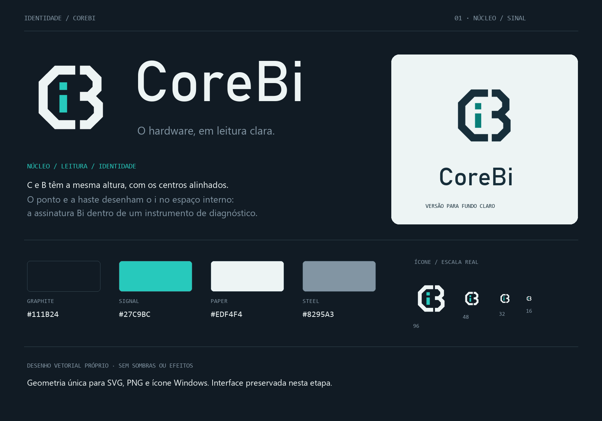

# CoreBi

[](https://github.com/GabrielAngelimm/CoreBi/actions/workflows/verify.yml)
[](LICENSE)

Monitoramento, diagnóstico e testes reais de hardware para Windows x64. **Cór-bi**, de Core + Bi.



**0.1.1 · prévia técnica.** Base independente derivada de [ResetExplode](https://github.com/GustavoReset/ResetExplode), em C#/.NET 10 e WPF. A coleta e os algoritmos ficam separados da apresentação; o layout atual foi preservado para a futura etapa de UI/UX. Créditos e licenças estão em [NOTICE.md](NOTICE.md).

## O que inclui

| Seção | Ferramentas |
| --- | --- |
| Visão geral | Resumo do computador, histórico de sensores e alertas |
| Monitoramento | Sistema, sensores, placa de vídeo, discos, energia e rede |
| Jogos | FPS estimado, análise de gargalo e overlay por ETW |
| Desempenho | Benchmarks de CPU, GPU, DXR, simulação, RAM, carregamento e disco; stress de CPU, RAM e GPU |
| Ferramentas | Inicialização, drivers e instalação de apps via winget |

As ferramentas executam coleta ou trabalho real. FPS estimado e classificação de gargalo são modelos aproximados; não equivalem a um jogo medido. O catálogo de jogos serve às estimativas. Maker/COM, RGB, otimização, overclock e launcher não fazem parte desta versão. Veja [fontes e limites de cada ferramenta](docs/FEATURES.md).

## Usar

Baixe o pacote `CoreBi-*-win-x64.zip` em [Releases](https://github.com/GabrielAngelimm/CoreBi/releases), extraia **todo o conteúdo** e abra `CoreBi.exe`. O pacote inclui o runtime .NET; o SDK só é necessário para desenvolvimento. O Windows solicita administrador, exigido atualmente pelo acesso a sensores/ETW e ferramentas administrativas.

Sensores internos de CPU dependem do driver PawnIO e do suporte do LibreHardwareMonitor ao equipamento. A instalação do driver é uma ação explícita na interface. Instalações de apps/drivers e alterações na inicialização também dependem de uma ação do usuário.

Dados e históricos ficam em `%AppData%\CoreBi`. A chave opcional da API é protegida por DPAPI para o usuário Windows atual. Backups de inicialização e downloads administrativos ficam em `%ProgramData%\CoreBi\<SID>`, com acesso restrito a Administradores e SYSTEM. Não apague essa pasta se pretende restaurar entradas removidas. [Privacidade](PRIVACY.md) e [segurança](SECURITY.md) descrevem os dados e os limites.

## Compilar

Requisitos: Windows x64, Git e SDK indicado em `global.json` (10.0.402, com atualizações de patch permitidas). No PowerShell, na raiz do repositório:

```powershell
git clone https://github.com/GabrielAngelimm/CoreBi.git
cd CoreBi
dotnet restore CoreBi.slnx --locked-mode
.\tools\Build.ps1
dotnet run --project src/CoreBi.Desktop
```

Para um SDK portátil, defina `$env:COREBI_DOTNET` com o caminho do `dotnet.exe`. Não é necessário modificar o SDK global. Para gerar o pacote self-contained:

```powershell
.\tools\Publish.ps1
```

Resultado: `artifacts/publish/win-x64`, incluindo licenças. Os locks de build e publicação são separados porque single-file acrescenta ferramentas de linking.

## Verificar

```powershell
.\tools\Test.ps1                       # 24 regressões e construção/navegação WPF
.\tools\Test.ps1 -Mode Hardware        # inventários, sensores, armazenamento; ETW se elevado
.\tools\Test.ps1 -Mode Startup         # carga real no dispatcher WPF sem ativar a janela
.\tools\Test.ps1 -Mode Integrations    # consultas externas; ACL se elevado
.\tools\Test.ps1 -Mode Bench           # cargas reais curtas; CPU/GPU/RAM/disco
.\tools\SecretScan.ps1                 # Gitleaks fixado; histórico Git, saída redigida
```

Os testes isolam configurações em `artifacts/tests/settings`. Não instalam software nem modificam entradas reais de inicialização. `Bench` gera carga e arquivos temporários e deve ser executado com outras tarefas pesadas encerradas. Seus presets reduzidos verificam execução; não certificam desempenho ou estabilidade térmica. A CI executa regressões/WPF, build e publicação; testes dependentes de GPU, privilégios e serviços externos ficam separados.

## Desenvolvimento

- [Arquitetura e responsabilidades](docs/ARCHITECTURE.md)
- [Implementação e confiabilidade das ferramentas](docs/FEATURES.md)
- [Evidências, cobertura e pendências](docs/VALIDATION.md)
- [Manutenção e contribuição](CONTRIBUTING.md)
- [Identidade visual](DESIGN.md) e [contrato da interface](UX-CONTRACT.md)
- [Mudanças](CHANGELOG.md), [MIT](LICENSE) e [licenças de terceiros](THIRD-PARTY.md)

A versão foi validada funcionalmente na máquina descrita na documentação. Instalações administrativas, múltiplos equipamentos, acessibilidade e precisão do FPS em jogos ainda precisam de testes específicos. Não há certificação geral de produção ou equivalência com utilitários comerciais.
